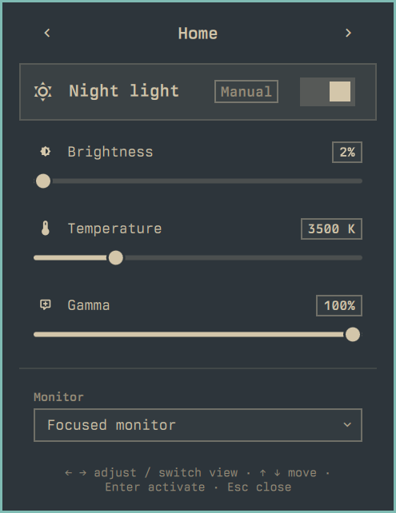
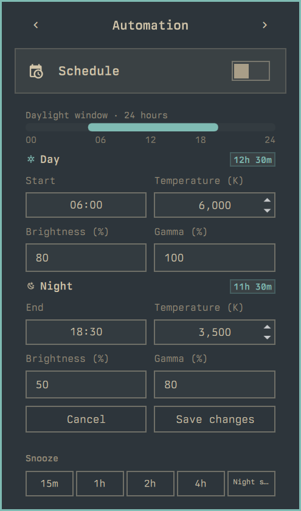
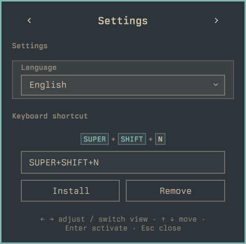

<div align="center">

# Veilleuse

Brightness, night light, and day/night schedules for the Omarchy Quattro bar.

[](https://github.com/ZnOw01/Veilleuse/actions/workflows/checks.yml)
[](https://github.com/ZnOw01/Veilleuse/releases)
[](LICENSE)

</div>

Veilleuse is a native Omarchy Quattro shell plugin. Its bar widget opens a panel with three views: **Home** for brightness and night light, **Automation** for the day/night schedule and snooze, and **Settings** for language and an optional keyboard shortcut.

## Screenshots

| Home | Automation | Settings |
| :--: | :--------: | :------: |
|  |  |  |

## Features

- Brightness from 1 to 100% for the focused display or a named monitor, through `omarchy-brightness-display`.
- Global night light temperature from 2500 to 6500 K and gamma from 0 to 100%, through `hyprsunset`.
- Day/night schedule with optional brightness and gamma for each period, plus timed snooze.
- Keyboard navigation, pointer hover focus, and English or Spanish interface text.
- Optional Hyprland shortcut with collision checks and a one-time backup of `bindings.lua`.
- Python standard library only. Private state uses atomic replacement and mode `0600`, and no extra daemon runs in the background.

## Requirements

- Omarchy Quattro with its shell/plugin tooling and QML components (`qs.Commons`, `qs.Ui`).
- Hyprland and a running `hyprsunset` backend.
- Python 3.12+ with `omarchy-monitor-state` and `omarchy-brightness-display` on `PATH`.

There are no Python packages to install. Node.js is only needed for development tests. The QML files are a shell plugin, not a standalone application.

## Installation

Run from an Omarchy desktop session:

```bash
omarchy plugin add https://github.com/ZnOw01/Veilleuse.git --enable --yes
```

Click the Veilleuse bar widget to open the panel, or use shell IPC:

```bash
omarchy shell io.github.znow01.veilleuse toggle
```

Update the plugin and reload the shell:

```bash
omarchy plugin update io.github.znow01.veilleuse --yes
omarchy restart shell
```

Before uninstalling, remove any shortcut installed through Settings or `shortcut remove`; removing the plugin does not clean up that binding. Then run:

```bash
omarchy plugin remove io.github.znow01.veilleuse --yes
```

Removal leaves Veilleuse state, `hyprsunset.conf`, and user configuration backups in place. If you disabled a schedule and want it restored, enable it before removing the plugin.

## Configuration

No API keys or credentials are required. The panel stores preferences in Omarchy's inline bar-entry settings (`~/.config/omarchy/shell.json`):

| Setting | Default | Purpose |
| --- | --- | --- |
| `locale` | `en` | Interface language (`en` or `es`) |
| `monitor` | `focused` | Brightness target: focused display or an enabled monitor name |
| `shortcutKeys` | `SUPER+SHIFT+N` | Shortcut editor value; does not install a binding by itself |
| `helperPath` | Bundled `scripts/veilleuse-control` | Optional helper executable override, typically for development |

These settings are separate from `~/.config/veilleuse/config.json`, which stores only the backend schema. Do not add language or monitor fields to that file.

The helper reads these environment variables:

| Variable | Required | Purpose |
| --- | --- | --- |
| `XDG_CONFIG_HOME` | No | Absolute configuration base; defaults to `~/.config` |
| `XDG_STATE_HOME` | No | Absolute private-state base; defaults to `~/.local/state` |
| `HOME` | Normal user environment | Home directory used for fallback paths |
| `PATH` | Normal Omarchy environment | Resolves Python and native backend commands |
| `PYTHON` | No; check scripts only | Interpreter for `scripts/check.sh` and `scripts/check_hygiene.sh`; defaults to `python3` |

Relative XDG bases fall back to the home-directory defaults. Shell IPC uses the session environment, so run IPC commands from the desktop session.

## Usage

### Home

Night light, brightness, temperature, and gamma. Monitor selection changes the brightness target; color temperature and gamma are global `hyprsunset` controls.

### Automation

Edits day/night times in 24-hour `HH:MM` format:

- Day temperature accepts 5900 to 6500 K. Values at or above 6000 K are written to `hyprsunset.conf` as natural color (`identity = true`).
- Night temperature accepts 2500 to 5000 K.
- Brightness (1 to 100%) and gamma (0 to 100%) are optional per period. Leave a field blank to omit that period's scheduled display value.
- Snooze applies natural color for the selected duration.

Enable a disabled schedule before saving edits. Its saved values remain visible while disabled.

Veilleuse reconciles schedule and snooze state every 30 seconds while the panel component is loaded, including when the panel is closed. Pending requests defer reconciliation. If the shell or plugin stops, Veilleuse does not apply scheduled brightness or gamma and does not process snooze expiration until reconciliation resumes. Native `hyprsunset` scheduling is separate.

### Settings

Selects the interface language and manages the optional global shortcut. Veilleuse never installs a shortcut on its own, and installation checks `bindings.lua` for conflicts first.

### Keyboard

| Input | Action |
| --- | --- |
| `↑` / `↓` | Move the cursor between rows |
| `←` / `→` on a slider | Adjust brightness or gamma by 1 percentage point, temperature by 50 K |
| `←` / `→` on other rows | Navigate views or grouped actions, depending on the row |
| `Enter` / `Space` | Activate the focused control or open its editor/dropdown |
| `Esc` | Leave an editor, close a dropdown, or dismiss the panel |
| Pointer hover | Focus the hovered row for keyboard adjustment |

Text editors and dropdowns handle their own keys while focused. See [CLI.md](CLI.md) for diagnostics, display commands, schedule examples, shortcut management, and shell IPC.

### Global shortcut

Run these commands from the repository root or the installed plugin directory:

```bash
./scripts/veilleuse-control shortcut status
./scripts/veilleuse-control shortcut install --keys "SUPER, V"
./scripts/veilleuse-control shortcut remove
```

Installation manages only this block in `~/.config/hypr/bindings.lua`:

```lua
-- >>> Veilleuse shortcut >>>
o.bind("SUPER + V", "Veilleuse", "omarchy-shell -q io.github.znow01.veilleuse toggleNightlight")
-- <<< Veilleuse shortcut <<<
```

Before the first installation or update, the helper creates a `bindings.lua.bak` backup. Removal deletes only the managed block and preserves other edits. Check the returned `reload` result: the file can be saved even when `hyprctl reload` fails.

## Diagnostics

Run from the repository root or the installed plugin directory:

```bash
./scripts/veilleuse-control status
./scripts/veilleuse-control preflight
./scripts/veilleuse-control shortcut status
```

`status` and `preflight` exit zero even when their JSON payload reports unavailable backends. Check `preflight.ok` and each status section's `available` and `error` fields. See the [CLI reference](CLI.md) for response handling.

## Troubleshooting

| Symptom | Check or action |
| --- | --- |
| A slider shows `—` or a backend is unavailable | Run `status` and `preflight`; inspect the JSON availability and error fields. Check the running `hyprsunset` backend and detected monitor names. Independent controls can still work. |
| Arrow keys change views instead of a slider | Hover the slider row or select it with `↑` / `↓`. |
| Updated UI is not visible | Run `omarchy restart shell` to reload the QML components. |
| Shortcut does not trigger | Run `shortcut status`, check for collisions and reload errors, and confirm the plugin is loaded. |
| Schedule or snooze does not resume | Confirm the shell and plugin are loaded, then run `reconcile` to apply the current state. |
| A schedule transaction reports a conflict | Review `hyprsunset.conf` and its backup before retrying. Keep the pending recovery record; do not overwrite it to bypass the conflict. |

## Development

Run both quality gates from a checkout:

```bash
./scripts/check.sh
./scripts/check_hygiene.sh
```

CI uses Python 3.12 and Node.js 24. Tests cover backend behavior, JavaScript models, and QML source contracts; they do not launch a real GUI. The gate runs `qmllint` and `omarchy-plugin-validate` when available and prints `SKIP` otherwise. See [CONTRIBUTING.md](CONTRIBUTING.md) for setup and review expectations, and [TEST_INFRA.md](TEST_INFRA.md) for test commands and limits.

## Documentation

| Document | Purpose |
| --- | --- |
| [CLI.md](CLI.md) | Commands, parameters, response handling, and shell IPC |
| [PROJECT.md](PROJECT.md) | Component map, request flow, persistence, and safety contracts |
| [CONTRIBUTING.md](CONTRIBUTING.md) | Development environment, verification, and contribution conventions |
| [TEST_INFRA.md](TEST_INFRA.md) | Automated coverage and manual verification limits |
| [CHANGELOG.md](CHANGELOG.md) | Release history |
| [AUDIT.md](AUDIT.md) | Dated technical audit and its verification evidence |

## License

[MIT](LICENSE), copyright 2026 ZnOw01.
